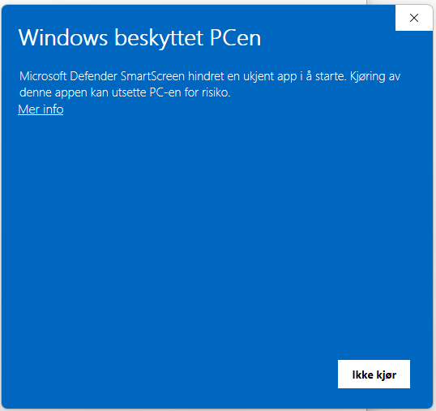
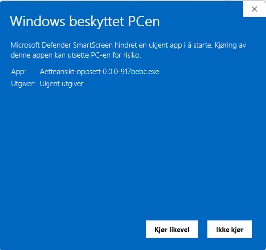

# Ætteansikt – ansikter og slekt fra gamle bilder

Ætteansikt kjenner igjen ansiktene på gamle familiebilder og hjelper deg å finne
ut hvem de var. Appen kjører på din egen maskin: bildene, navnene og alt du gjør,
blir liggende der. Ingenting sendes noe sted uten at du selv trykker.

Appen er i beta og deles foreløpig med familien.

**Last ned:** under [Releases](../../releases) ligger den nyeste versjonen.
Velg `Aetteansikt-oppsett-….exe` for Windows eller `Aetteansikt-….dmg` for Mac.

---

## Installere på Windows

1. Last ned `Aetteansikt-oppsett-<versjon>.exe` fra den nyeste versjonen under
   Releases.
2. Åpne fila. Windows viser trolig en blå advarsel, *«Windows beskyttet
   PC-en»*. Den kommer fordi appen ikke er signert av en kjent utgiver, ikke
   fordi noe er galt med den.
   Trykk **Mer info**, og så **Kjør likevel**.

   
   

3. Følg installasjonen. Den trenger ikke administrator, og du kan velge en
   snarvei på skrivebordet.
4. Start **Ætteansikt** fra Start-menyen eller skrivebordet. Et svart vindu
   åpnes, og så åpner appen seg i nettleseren.
   **La det svarte vinduet stå åpent mens du bruker appen** – det er selve
   appen. Når du er ferdig, trykker du **⏻** øverst til høyre i appen, eller
   lukker det svarte vinduet.

   

**Ny versjon:** last ned og kjør den nye installasjonsfila. Den erstatter den
gamle, og bildene og navnene dine beholdes.

**Avinstallere:** Start-menyen → *Avinstaller Ætteansikt*, eller Innstillinger
→ Apper. Bildene og navnene blir liggende i
`%LOCALAPPDATA%\Ætteansikt` til du sletter mappa selv.

## Installere på Mac

Appen er laget for Mac med Apple-brikke (M1 og nyere).

1. Last ned `Aetteansikt-<versjon>.dmg` fra den nyeste versjonen under
   Releases, og åpne den.
2. Dra **Ætteansikt** over på **Programmer** i vinduet som åpnes.

   

3. Åpne Ætteansikt fra Programmer. Første gang sier macOS at appen ikke kan
   åpnes fordi utgiveren ikke er kjent. Trykk **Ferdig** (eller **OK**).
4. Åpne **Systeminnstillinger → Personvern og sikkerhet**, bla ned til
   *Sikkerhet*, og trykk **Åpne likevel** ved Ætteansikt. Bekreft med passordet
   ditt.

   

5. Appen åpner seg i nettleseren. Etter dette starter den som vanlig.

**Avslutte:** appen har ikke noe eget vindu på Mac og kjører til du avslutter
den. Trykk **⏻** øverst til høyre i appen når du er ferdig. Å lukke fanen i
nettleseren er ikke nok.

**Ny versjon:** åpne den nye .dmg-en og dra Ætteansikt til Programmer igjen;
velg *Erstatt*. *Åpne likevel* kan trengs på nytt. Bildene og navnene
beholdes.

**Avinstallere:** dra Ætteansikt fra Programmer til papirkurven. Bildene og
navnene blir liggende i `~/Library/Application Support/Ætteansikt` til du
sletter mappa selv.

---

## Første gang

- Et velkomstvindu lar deg velge tilleggsmoduler (Forskning og Slektstre),
  legge inn en Claude-nøkkel om du har en, og velge hvor sikkerhetskopien skal
  ligge. Alt kan også gjøres senere under ⚙.
- Appen ber om å laste ned ansiktsmodellene (289 MB). Det er bare en
  nedlasting – ingenting om bildene dine sendes.
- Trykk **?** øverst i appen for bruksanvisningen. *Kom i gang* står først.

## Spørsmål og feil

Trykk **💬** øverst i appen der noe ser galt ut, og skriv hva du ser. Under
*Hva nå?* kan du laste ned tilbakemeldingene som én zip-fil og sende den på
e-post til den som ga deg appen.
